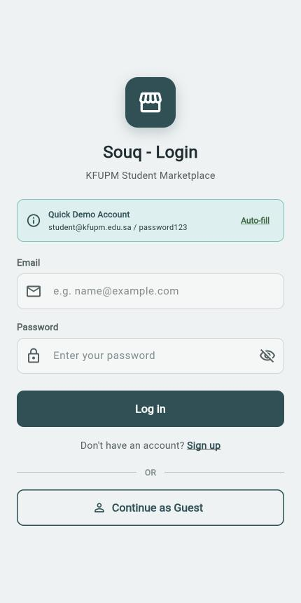
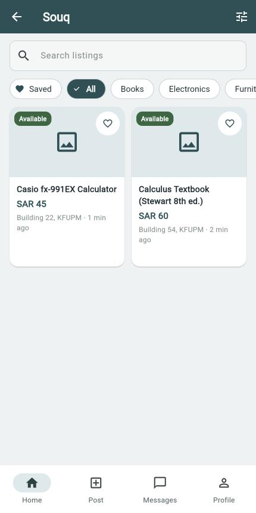
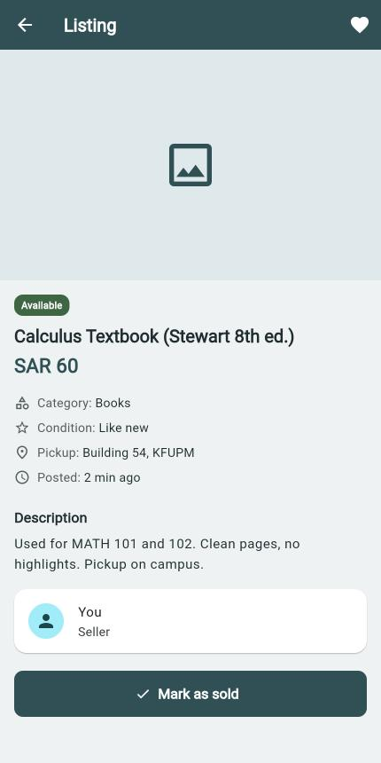
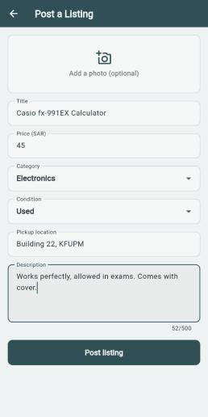
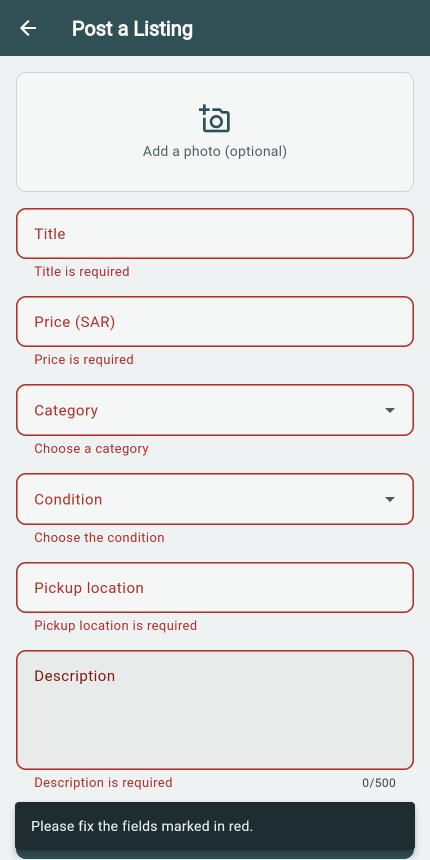
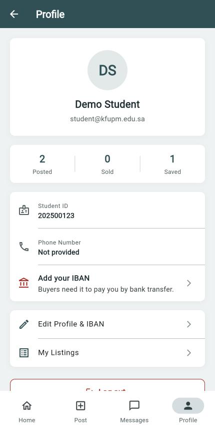

# SWE 463: Mobile Application Development — Project
# Souq (Student Marketplace App)

Souq is a marketplace app for KFUPM students to buy and sell used items (books, electronics, furniture and more) inside the university community. Students post listings with a photo, browse and filter them, chat with sellers in real time, save favorites, and copy the seller's IBAN for a quick bank transfer. All data is stored in Firebase, so every student sees the same listings and chats.

## Group 1 | Team Members

* **Abdulwahab Badirah** (202160410)
* **Abdulwahed Al Adi** (202256380)
* **Ayman Musalli** (202270440)
* **Hady Al Saleem** (202279620)

## Links

* GitHub repository: https://github.com/Abdulwahed25/SWE-463_project
* Live web demo: https://abdulwahed25.github.io/SWE-463_project/
* Figma design: https://www.figma.com/design/8lxB3Gc4IseCK7GgjLE7yf
* Final version: Git tag `final-submission` (the Android APK is attached to its GitHub release)

## Screenshots

| Login | Home | Listing Detail |
|---|---|---|
|  |  |  |

| Post Listing | Validation errors | Profile |
|---|---|---|
|  |  |  |

## How to Run

1. Install Flutter (stable channel) and Chrome, or an Android emulator or phone.
2. Clone the repository:
   ```bash
   git clone https://github.com/Abdulwahed25/SWE-463_project.git
   cd SWE-463_project
   ```
3. Get the packages:
   ```bash
   flutter pub get
   ```
4. Run the app:
   ```bash
   flutter run -d chrome
   ```
   or on Android: `flutter run -d <device-id>`
5. Run the tests and the analyzer:
   ```bash
   flutter test
   flutter analyze
   ```

Or open the live web demo with no install, or install the APK from the `final-submission` release on an Android phone.

### Test account

* Demo account: `student@kfupm.edu.sa` / `password123` (the **Auto-fill** button on Login fills it in).
* You can also sign up a new account. To test chat, use two accounts (for example the demo account and a new one).

## Firebase Setup

The app uses the Firebase project `souq-kfupm` (free Spark plan). Nothing needs to be set up to run it: the settings are already in `lib/firebase_options.dart`.

* **Firebase Auth** (Email/Password) for accounts.
* **Cloud Firestore** for users, listings, chats and messages.
* `lib/firebase_options.dart` has the web and Android app settings. These keys only identify the project, they are not secrets. Access is controlled by the security rules.
* `firestore.rules` holds the security rules (also published in the Firebase console):
  * Anyone can read listings; only the seller can create, edit or mark a listing as sold.
  * Only signed-in users can read user profiles; each user can only change their own profile.
  * Only the two people in a chat can read it or send messages in it, and a message must be sent by the signed-in user.

To use your own Firebase project instead: create a project, enable Email/Password sign-in and Firestore, run `flutterfire configure` to make a new `firebase_options.dart`, and publish `firestore.rules`.

## Final Features

| Feature | Type | Status | Where |
|---|---|---|---|
| Post a listing (form with validation, optional photo, posting state, success screen) | Essential | Complete | Post tab |
| Browse, search and filter listings (category, max price, available only) | Essential | Complete | Home |
| Listing status: available or sold (badge, Mark as sold, My Listings tabs) | Essential | Complete | Listing Detail, My Listings |
| In-app messaging (live chat with Firestore streams, photos in chat, unread badges, chat search) | Essential | Complete | Listing Detail, Messages, Chat |
| User accounts and profiles (Firebase Auth, edit profile, phone and IBAN validation) | Essential | Complete | Login, Sign Up, Profile, Edit Profile |
| IBAN quick-transfer helper (seller's IBAN sheet on a listing, copy IBAN) | Essential | Complete | Edit Profile, Listing Detail |
| Keyword search | Optional | Complete | Home, Messages |
| Favorites (heart, "Saved" filter, saved to the account) | Optional | Complete | Home, Listing Detail, Profile |
| Guest browsing | Extra | Complete | Login (Continue as Guest) |
| Seller profile (seller details and their listings) | Extra | Complete | Listing Detail |

### How to test the main flow

1. Log in with the demo account.
2. Press **Post**, then press **Post listing** with the form empty: each required field shows a red error.
3. Fill in the form (optionally add a photo) and press **Post listing**. The button shows "Posting...", then the success screen opens.
4. Press **Back to Home**: the new listing is first. Open the app on another device or browser: the listing is there too (stored in Firestore).
5. Open the listing and press **Mark as sold**: the badge changes to Sold on Home and in My Listings.

### How to test the messaging flow

1. Sign up account A and post a listing. Log out.
2. Log in as the demo account (account B), open account A's listing and press **Message seller**.
3. Press **Send** with an empty box: "Type a message first." appears and nothing is sent. Type a message and send it.
4. Log in as account A in another browser or phone: the message appears live, and the Messages tab shows an unread badge. Reply, and the reply appears for account B without refreshing.

## Project Structure

```
lib/
  main.dart                 Firebase start-up, providers and MaterialApp
  firebase_options.dart     Firebase settings for web and Android
  app_routes.dart           route names and screens
  theme.dart                Material 3 theme (Souq colors)
  models/                   Listing, Chat, Message, User, categories, countries
  providers/                AuthProvider, ListingsProvider, ChatProvider
  services/                 repository interfaces and their Firebase versions
  screens/                  one file per screen
  widgets/                  reusable widgets (listing card, chat bubble, photo view, IBAN and phone fields, ...)
  utils/                    formatting, IBAN and phone helpers, validators, photo picker
test/                       provider, validator and widget tests with fake repositories
firestore.rules             Firestore security rules
.github/workflows/          web demo build (with analyze and tests) and Android APK build
```

## State Management and Data

* **Provider** (ChangeNotifier) for shared state:
  * `AuthProvider`: the signed-in student, login, sign up, logout and profile updates.
  * `ListingsProvider`: listings, search, filters, favorites, and the loading and error states. It follows `AuthProvider` to load the signed-in student's favorites.
  * `ChatProvider`: the student's chats and the open chat's messages, kept live with Firestore streams. It follows `AuthProvider` through a `ChangeNotifierProxyProvider`.
* **setState** for state that belongs to one screen (form fields, the posting flag, the selected tab).
* **Repository pattern:** screens and providers only use the `AuthRepository`, `ListingRepository` and `ChatRepository` interfaces. The app uses `FirebaseAuthRepository`, `FirestoreListingRepository` and `FirestoreChatRepository`; the tests use fake versions.

### Firestore data

| Collection | Fields |
|---|---|
| `users/{uid}` | id, name, studentId, email, phone, iban, favoriteIds |
| `listings/{id}` | title, price, category, condition, location, description, photo, sellerId, sellerName, status (available or sold), createdAt |
| `chats/{id}` | listingId, participantIds, participantNames, lastMessage, lastMessageAt, unreadCount (per user) |
| `chats/{id}/messages/{id}` | senderId, text, photo, sentAt |

Photos are compressed (800 px, quality 60) and saved as base64 text inside the document, up to 600 KB. Firebase Storage needs the paid plan, so we did not use it.

## Testing

* `flutter test`: **62 tests pass** (auth, listings, favorites, chat, profile, phone and IBAN validators, and widget tests for the profile screens).
* `flutter analyze`: no errors or warnings.
* GitHub Actions runs `flutter analyze` and `flutter test` on every push before building the web demo. A second workflow builds the release APK.
* Manual testing on the live web demo: sign up, login, post with validation errors, post a listing, home list, favorites saved to the account, listing detail, profile counts, logout.

## Packages

| Package | Why we use it | License |
|---|---|---|
| firebase_core | Connect the app to Firebase | BSD-3-Clause |
| firebase_auth | Accounts (email and password) | BSD-3-Clause |
| cloud_firestore | Store users, listings, chats and messages; live chat streams | BSD-3-Clause |
| provider | Share app state between screens | MIT |
| image_picker | Pick a photo for a listing or a chat message | Apache-2.0 / BSD-3-Clause |
| cupertino_icons | iOS style icons (comes with Flutter) | MIT |

## Known Limitations

* Video messages were removed: they need Firebase Storage, which is not on the free plan. Chat supports text and photos.
* One photo per listing, and photos must be under 600 KB after compression.
* The app is built for web and Android. iOS was not set up (no Mac signing setup in the team).
* No push notifications; new messages show when the app is open (live) or on the next open.
* No in-app payment: the IBAN helper only copies the seller's IBAN for a bank transfer outside the app.
* Changing your name does not update the seller name on listings you posted before.
* `flutter analyze` shows information notes (not warnings) because newer Flutter versions suggest the new `material_ui` import.

## Contributions

| Member | Main work |
|---|---|
| Abdulwahab Badirah | Project setup, user accounts (models, AuthProvider, Login, Sign Up, first Profile and Edit Profile), guest browsing, auth tests |
| Abdulwahed Al Adi | Listings feature (model, provider, Home, filters, Post Listing, Listing Detail, Mark as sold, My Listings, favorites), finished messaging in Phase 3, Phase 4 Firebase move (Auth, Firestore, rules, live chat, photos, saved favorites), CI workflows, README and reports |
| Ayman Musalli | Profile and IBAN helper: phone field with country codes, IBAN validation, Profile stats, Edit Profile, seller IBAN sheet, profile tests |
| Hady Al Saleem | In-app messaging: chat models, ChatProvider, Chat and Messages screens, chat bubbles, photo messages, seller profile screen |

The full history is in the commit log on GitHub.

## Sources and Licenses

* Flutter and Dart documentation: https://docs.flutter.dev
* FlutterFire documentation: https://firebase.flutter.dev
* Firebase documentation (Auth, Firestore, security rules): https://firebase.google.com/docs
* Package licenses are listed in the Packages table above (from pub.dev).
* Icons: Material Icons (Apache-2.0), included with Flutter.
* No images or code from other projects were copied.

## AI Use Disclosure

AI use was allowed by the course instructor. We used an AI assistant (Claude) for:

* Screen design: the team decided the screens, features and style. AI helped turn these ideas into Figma screens and suggested layout and color improvements.
* Navigation diagram: AI helped draw the diagram from the flow the team defined.
* Code: AI helped write the theme and shared widgets, the listings feature and its tests, finishing the Phase 3 messaging feature, and the Phase 4 Firebase move (Firebase repositories, security rules, live chat streams, photos, saved favorites, updated tests and the APK workflow).
* Reports and README: AI helped write parts of the Phase 2, 3 and 4 reports and this README.
* Testing: AI helped run the manual tests on the live demo and take the screenshots.
* Spelling and grammar checks.

Every team member reviewed the AI-assisted work and can explain the code they are responsible for.
